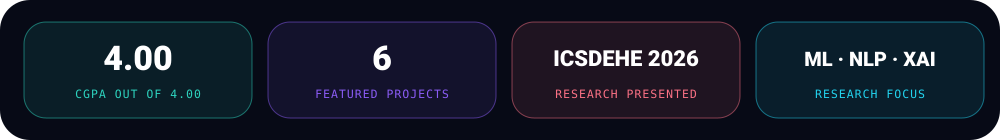
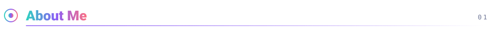
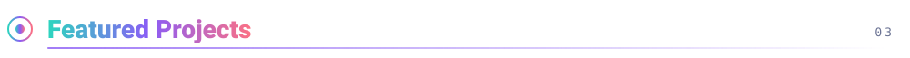

<!-- ============================================================
  SOCIAL LINKS: replace every YOUR_... text with your real link.
  Delete any badge line you do not want.
============================================================= -->

 

  

I am a Computer Science and Engineering student at **Port City International University, Chattogram, Bangladesh**, with a strong interest in **Artificial Intelligence, Machine Learning, Data Science and research**. I enjoy building practical, intelligent solutions to real-world problems, supported by sound statistical thinking.

- 🎓 B.Sc. in Computer Science and Engineering
- 🔬 Active in academic research, with work in air quality prediction, NLP and explainable AI
- 💻 Experienced in building web applications and software systems

 

**Research interests:** AQI prediction · environmental data analysis · model evaluation · NLP · hate-speech detection · Explainable AI · statistical significance testing · predictive analytics

**Research goal:** contribute to high-quality, peer-reviewed work in reputable Scopus and Web of Science indexed journals and conferences.

 

<table>
<tr>
<td width="50%" valign="top">

#### 🩸 [Blood Lagbe](https://github.com/nurmohammadakash/BloodLagbe-)
A real-time blood donation platform connecting donors with people in need. Includes donor and request management, OTP phone verification, password recovery, trust score and eligibility rules, live updates, and a blood-shortage forecasting model.
 `Node.js` `Express` `MySQL` `Socket.IO` `GraphQL` `Sass` `GSAP`

</td>
<td width="50%" valign="top">

#### 📅 Smart Routine Management System
Generates gap-free academic class schedules automatically, with conflict-aware scheduling, classroom and time-slot management, and teacher consultation slots. Built on CSP, round-robin and multi-pass scheduling ideas.
 `PHP` `MySQL` `JavaScript` `Sass` `GSAP`

</td>
</tr>
<tr>
<td width="50%" valign="top">

#### 🛡️ CPI Air Defense System
An Arduino radar and automated defense simulation: ultrasonic detection, a servo-driven 0–180° scanning sweep, LED and buzzer alerts and a servo-controlled launcher simulation.
 `Arduino UNO` `HC-SR04` `SG90 Servo`

</td>
<td width="50%" valign="top">

#### 🏦 Bank Account Management System
A database-driven banking web application that demonstrates account management and clean full-stack structure.
 `PHP` `MySQL` `JavaScript` `Sass` `GSAP` `Three.js`

</td>
</tr>
</table>

 

<table>
<tr><td width="170"><b>Languages</b></td><td></td></tr>
<tr><td><b>Web</b></td><td></td></tr>
<tr><td><b>ML & Libraries</b></td><td></td></tr>
<tr><td><b>Databases</b></td><td></td></tr>
<tr><td><b>Tools</b></td><td></td></tr>
</table>

**AI, ML & Data Science:** supervised and unsupervised learning · classification and regression · Naive Bayes · feature engineering · EDA · model evaluation · NLP · text classification · image analysis · Explainable AI · hypothesis testing

**Also:** Socket.IO · GraphQL · OpenGL and GLUT · Google Colab · Kaggle Notebooks · SPSS · XAMPP · cPanel · data structures and algorithms · operating systems · computer networks · software engineering · compiler design · IoT

 

| Role | Organisation | What I do |
|---|---|---|
| **Education Secretary** | Hashimukh Foundation | Supporting educational initiatives for underprivileged children, and blood donation coordination |
| **Former Blood Donation Secretary** | Agrogoti Youth Foundation | Took part in blood donation drives and community support |
| **Member** | Leo Club | Community service and leadership activities |

 

- Deepening my knowledge of **Machine Learning and Deep Learning**
- Exploring **NLP and Explainable AI** through research-oriented projects
- Strengthening statistical analysis and research methodology
- Building practical software applications
- Preparing for international postgraduate opportunities in Computer Science and AI

 

I enjoy connecting with researchers, developers, students and technology enthusiasts.

 

  

<picture>
  <source media="(prefers-color-scheme: dark)" srcset="https://raw.githubusercontent.com/nurmohammadakash/nurmohammadakash/output/github-snake-dark.svg"/>
  <source media="(prefers-color-scheme: light)" srcset="https://raw.githubusercontent.com/nurmohammadakash/nurmohammadakash/output/github-snake.svg"/>
  
</picture>

 

